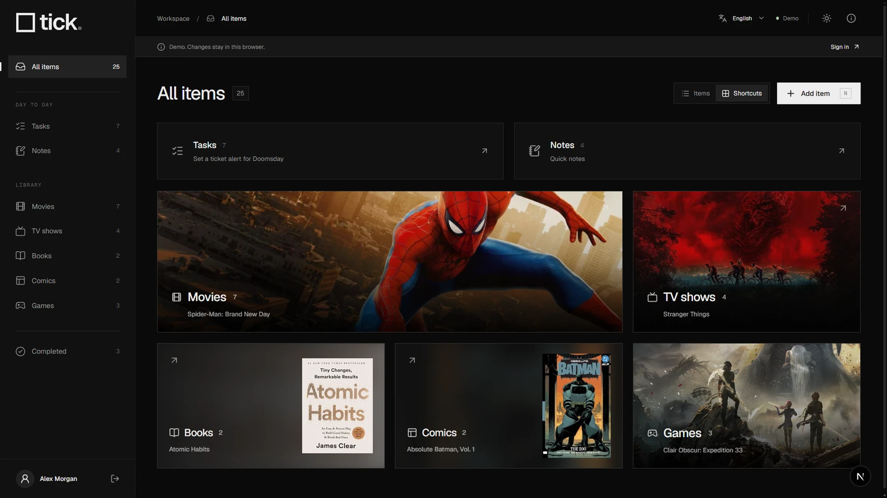
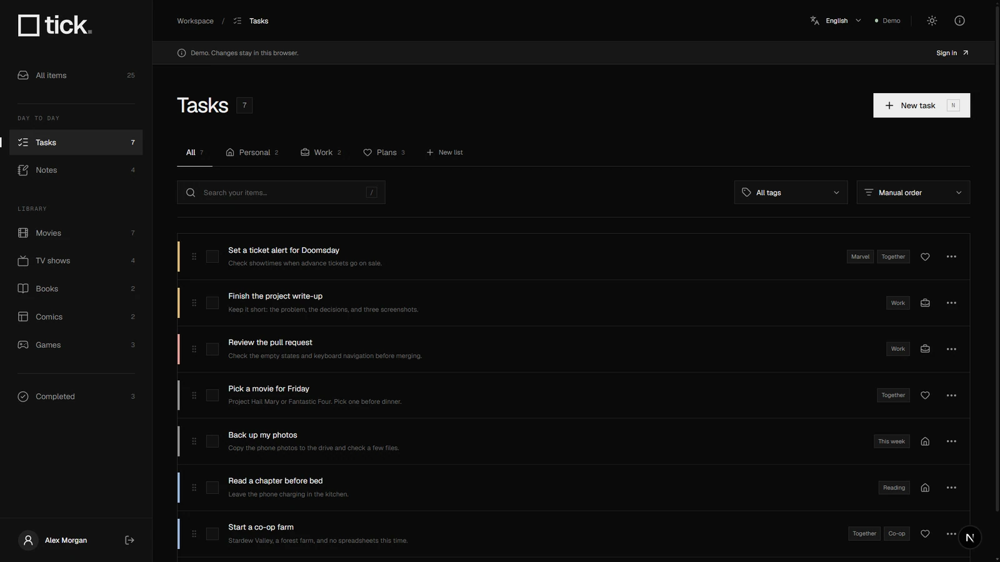
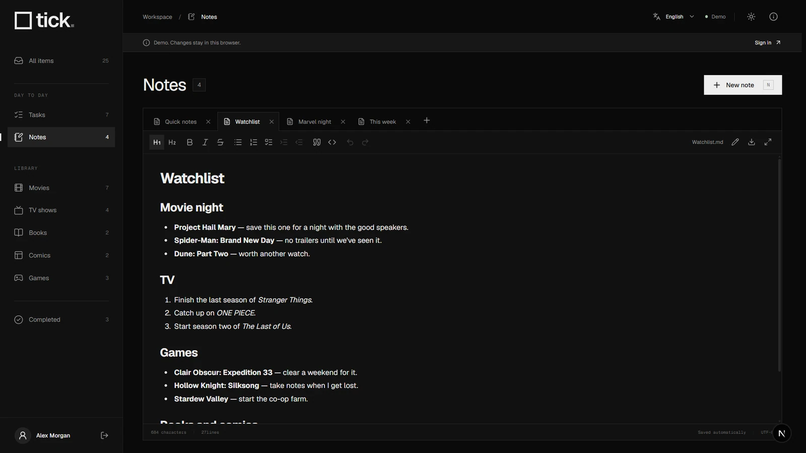
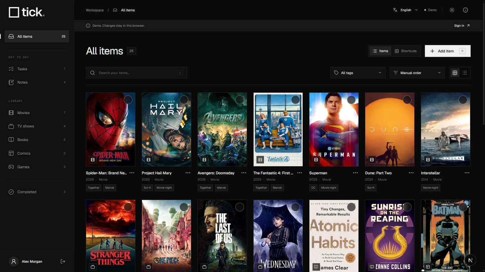
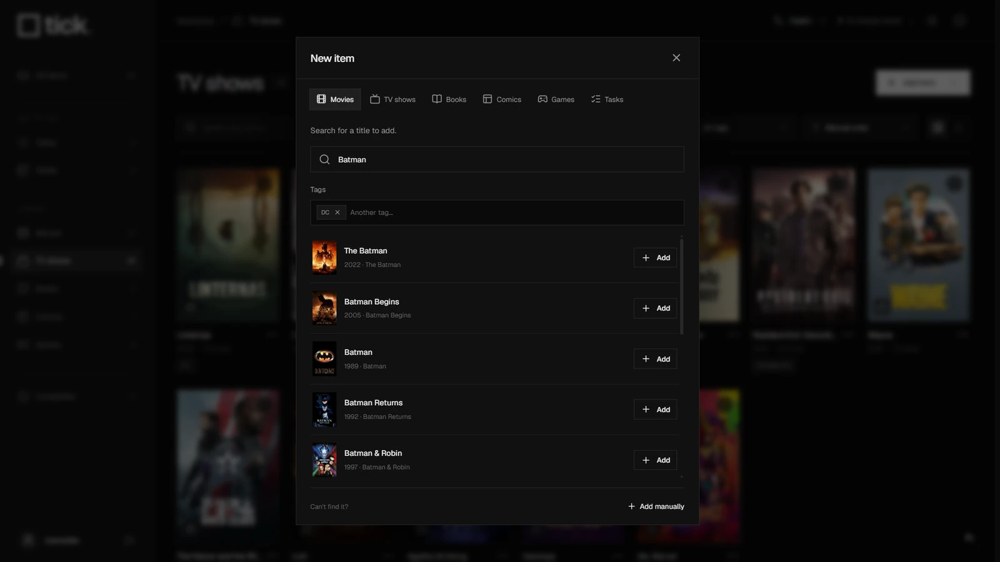
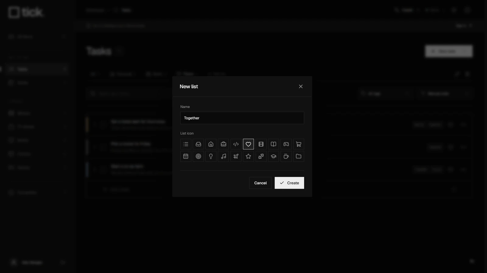
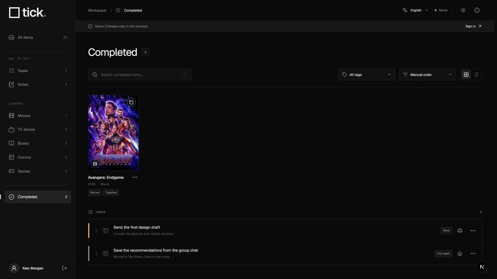

<p align="center">
  <picture>
    <source media="(prefers-color-scheme: dark)" srcset="docs/assets/tick-dark.svg" />
    
  </picture>
</p>

<p align="center">Media lists, tasks and Markdown notes.</p>
<p align="center">
  <a href="https://tick.johanamador.com/demo">Live demo</a> ·
  <a href="#try-it">Try it locally</a> ·
  <a href="#set-up-your-workspace">Setup</a> ·
  <a href="#deploy-to-vercel">Deploy</a> ·
  <a href="README.es.md">Español</a>
</p>

---

tick is a personal workspace for what you want to watch, read, play and get done. Run your own copy with Next.js and Supabase. Each installation has one private account and its own database.



## What you can do

- **Keep a watchlist.** Movies, TV shows, books, comics and games, with catalog search or manual entry. Check something off to move it to Completed; undo when needed.
- **Make it yours.** Tags, drag-and-drop ordering, grid and list views, or category shortcuts with artwork from your first pending title.
- **Organize tasks.** Separate lists with icons, tags and four priority levels.
- **Write notes.** Tabs, headings, bullets, checkboxes and Markdown export. Maximize the editor when you need the space.
- **Choose your setup.** English or Spanish, light or dark, and an optional profile photo.

| Tasks                                                                               | Markdown notes                                                                   |
| ----------------------------------------------------------------------------------- | -------------------------------------------------------------------------------- |
|  |  |

<details>
<summary>More screenshots</summary>

**Library**



**Catalog search**



**List icons**



**Completed**



</details>

## Try it

Requires **Node.js 24** and npm.

```sh
git clone https://github.com/johanamador/tick.git
cd tick
npm ci
npm run dev
```

Open **[127.0.0.1:3006/demo](http://127.0.0.1:3006/demo)**. The demo works without Supabase or API keys. Its English sample data and any changes stay in your browser.

## Set up your workspace

### 1. Create a Supabase project

Create a project at [supabase.com](https://supabase.com). The Free plan is enough to get started. In the SQL editor, run these migrations in order:

1. [Workspace tables and access policies](supabase/migrations/202610280001_workspace.sql)
2. [Games and tags](supabase/migrations/202610290001_games_tags.sql)
3. [Task priorities and Markdown notes](supabase/migrations/202610290002_priority_markdown.sql)
4. [Profiles and list icons](supabase/migrations/202610290003_profiles_list_icons.sql)

In **Authentication → Sign In / Providers**, disable new user signups. Keep email/password authentication enabled. tick provisions your account locally instead of offering public registration.

### 2. Add your environment variables

```sh
cp .env.example .env.local
```

PowerShell: `Copy-Item .env.example .env.local`.

Fill in these three values from your Supabase project's **Connect** dialog or API settings:

```dotenv
NEXT_PUBLIC_SUPABASE_URL=https://your-project.supabase.co
NEXT_PUBLIC_SUPABASE_PUBLISHABLE_KEY=your-publishable-key
SUPABASE_SECRET_KEY=your-secret-key
```

The secret key is used only by the local account setup command. Legacy `anon` and `service_role` keys also work in the corresponding public and secret settings. Leave the account variables blank for now.

### 3. Create your account

```sh
npm run admin
```

Choose a username, email and password of at least 12 characters. Password input is hidden. The command creates your account, profile and initial task lists, then writes `ADMIN_USER_ID`, `ADMIN_USERNAME` and `ADMIN_LOGIN_EMAIL` to `.env.local`. Your password is stored by Supabase Auth, never in the file. Running the command again preserves an existing account's password.

Restart the development server and open **[127.0.0.1:3006](http://127.0.0.1:3006)** to sign in. Set your display name and optional photo from the sidebar profile button.

## Catalogs

| Content       | Provider                                                                 | Key                                       |
| ------------- | ------------------------------------------------------------------------ | ----------------------------------------- |
| Movies and TV | [TMDB](https://www.themoviedb.org/settings/api)                          | `TMDB_READ_TOKEN` — API Read Access Token |
| Books         | [Open Library](https://openlibrary.org/developers/api)                   | None                                      |
| Comics        | Open Library; optional [Comic Vine](https://comicvine.gamespot.com/api/) | `COMIC_VINE_API_KEY`, optional            |
| Games         | Steam                                                                    | None                                      |

Add optional keys to `.env.local` and restart the server. Searches run on the server and cache catalog responses for 24 hours. Movies and TV need a TMDB token for search and shortcut backdrops; manual entry works without it. Cover art loads directly from the catalog providers.

## Deploy to Vercel

Set up your Supabase project and account first, following the steps above.

1. Fork this repository and import your fork into [Vercel](https://vercel.com/new).
2. Keep the **Next.js** preset, **Node.js 24.x** and the default install/build commands.
3. Add the following environment variables for Production. Copy the account values created by `npm run admin` from your `.env.local`.

   | Variable                               | Required                          |
   | -------------------------------------- | --------------------------------- |
   | `NEXT_PUBLIC_SUPABASE_URL`             | Yes                               |
   | `NEXT_PUBLIC_SUPABASE_PUBLISHABLE_KEY` | Yes                               |
   | `ADMIN_USER_ID`                        | Yes                               |
   | `ADMIN_USERNAME`                       | Yes                               |
   | `ADMIN_LOGIN_EMAIL`                    | Yes                               |
   | `TMDB_READ_TOKEN`                      | For movie/TV search and backdrops |
   | `COMIC_VINE_API_KEY`                   | Optional                          |

4. Deploy. Set your HTTPS deployment URL as the **Site URL** in Supabase Auth's URL configuration. Add your own domain in Vercel if you want one.

`SUPABASE_SECRET_KEY` is not needed on Vercel. The application uses the signed-in user's session and row-level security to access the database. The configured account ID is checked on the server as well. A new clone has no account, credentials or profile photo built in.

### Free-tier fit

For a small personal installation, **Vercel Hobby + Supabase Free** is a suitable starting point. There are no background jobs or persistent servers to run. Notes are saved as text, profile photos are resized in the browser, and the public demo does not query your database.

| Service                                             | Relevant limits                                                                                                 |
| --------------------------------------------------- | --------------------------------------------------------------------------------------------------------------- |
| [Vercel Hobby](https://vercel.com/docs/plans/hobby) | Personal, non-commercial use. Includes 100 GB of data transfer and 4 CPU-hours per month.                       |
| [Supabase Free](https://supabase.com/pricing)       | 500 MB database and 5 GB egress. Up to two active free projects. Projects may pause after a week of inactivity. |

Limits checked in October 2026; providers may change them. Staying free depends on your usage. If Supabase pauses your project, restore it from its dashboard before signing in. Free hosting does not guarantee uninterrupted availability.

## Development

```sh
npm run typecheck
npm test
npm run build
```

Translations live in `lib/translations.ts`; sample Markdown notes are in `content/demo/`. To update an existing installation, apply any new SQL migrations before deploying the matching application version.

## Credits

Made by [Johan Amador](https://johanamador.com). Built with [Next.js](https://nextjs.org), [Supabase](https://supabase.com), [Tiptap](https://tiptap.dev) and [Lucide](https://lucide.dev).

[MIT](LICENSE). Font and icon licenses are included in [THIRD_PARTY_NOTICES.md](THIRD_PARTY_NOTICES.md) and [public/fonts/LICENSE.txt](public/fonts/LICENSE.txt). Catalog metadata and artwork remain the property of their respective owners. This product uses the TMDB API but is not endorsed or certified by TMDB.
